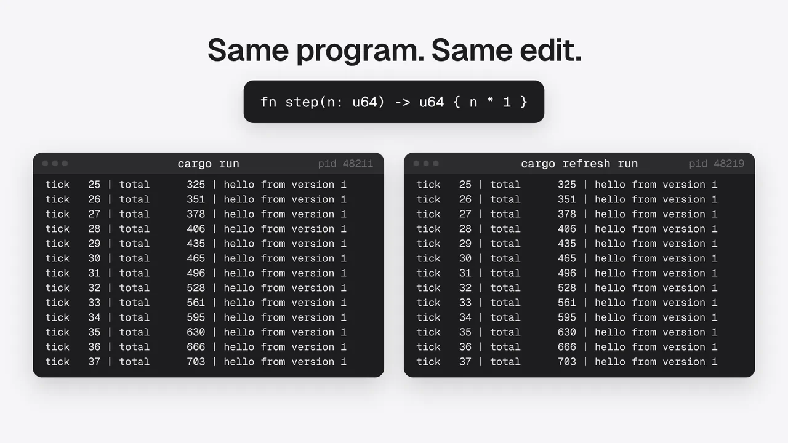
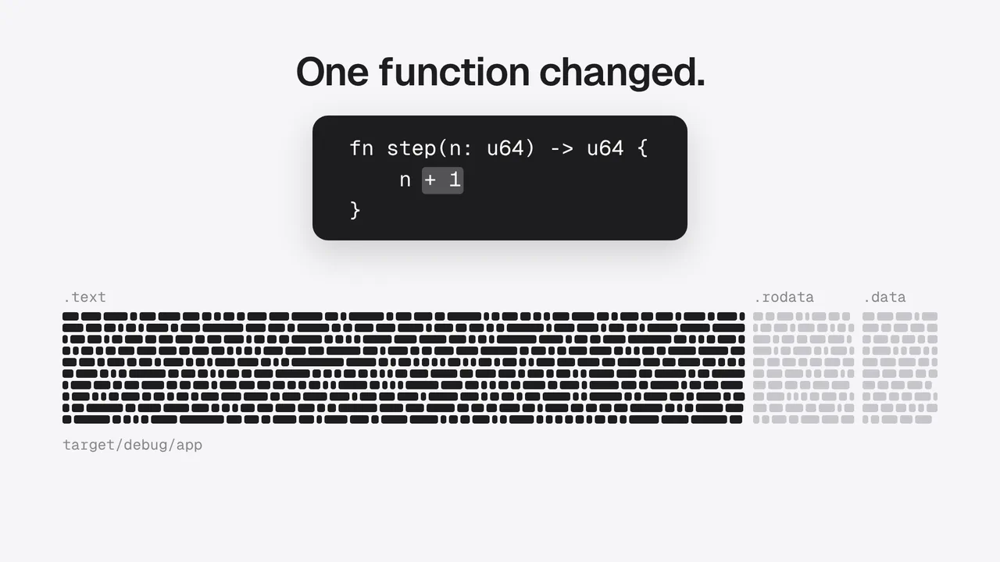
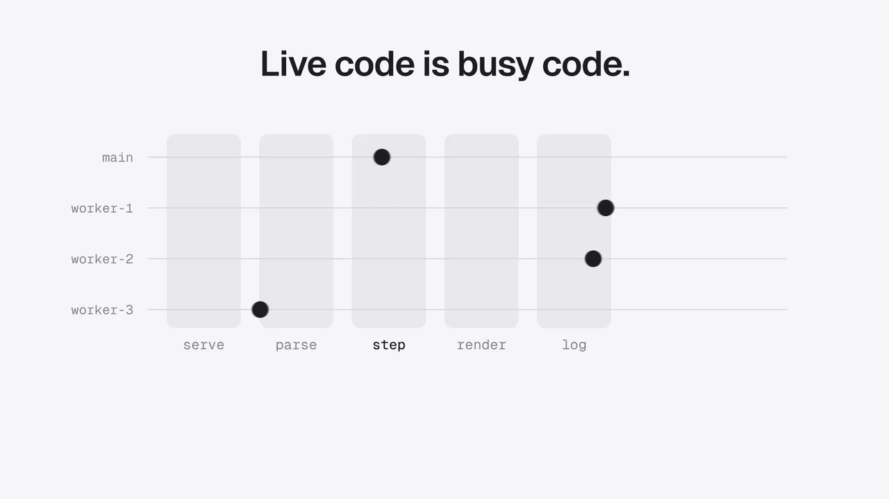

<picture>
  <source media="(prefers-color-scheme: dark)" srcset="media/brand/banner-dark.svg">
  
</picture>

**Hot reload for Rust.** cargo-refresh patches your changes into the running process, so
your state, your connections, and your flow stay right where they were.

> **About this project.** cargo-refresh delivers every idea it set out to prove: live
> patches into a running process, safe pauses for every thread, checks on suspended
> async tasks, and exact rustc compatibility. It was also the proving ground for
> [Moonbow](https://github.com/berezovyy/moonbow) and
> [Witness](https://github.com/berezovyy/witness), a test of whether a new AI harness
> can take a hard idea from scratch to a working result on its own. cargo-refresh is
> that result.

[](media/films/intro.mp4)

> [!NOTE]
> rustd, from the Dioxus team, showed that Rust code can compile in milliseconds, but
> every edit still ends with a restart, and the restart throws away the program's
> memory, its open connections, and whatever it was doing. cargo-refresh removes the
> restart, because it patches the new code into the program while the program runs. A
> patch agent inside the process pauses every thread at a safe moment and checks each
> thread's stack against the code that's about to change. It writes the patch only when
> no thread is affected, and the program keeps the same process and PID. Patches never
> overwrite old code, so saved closures and pointers keep working, and a panic in new
> code unwinds like a panic in the original program.
>
> cargo-refresh also decides, for every save, whether a live patch is safe. It records
> fingerprints of async tasks, so a paused task never wakes up in code that changed
> under it. It compiles with the exact data layouts and calling conventions of the rustc
> that built your program. When it can't prove an edit is safe, it restarts the program
> or runs a normal Cargo build, and a type error leaves the running program untouched.
> Assertion messages match stock rustc in 3,916 of 3,916 cases, and all 104 checks on
> real running apps match stock `cargo run`. The async safety tests pass 125 of 125, and
> edits designed to break it are caught in 50 of 50 cases. rustd provides the fast
> compiler, and cargo-refresh turns it into hot reload that you can trust with a running
> program.

After each save, `cargo refresh run` recompiles only the code you changed and patches
it into the running process. The program keeps its memory, its process ID
(PID), and its open network connections. When an edit can't be applied live,
cargo-refresh restarts the program or falls back to a normal Cargo build.

cargo-refresh is a proof of concept (PoC), and it shows that the hardest problems in hot
patching Rust can be solved. It updates a running Rust program without crashing it,
without changing what the program computes, and without leaving it in a state that a
normal build couldn't produce. Each claim below links to results that are recorded in
the repository, and the repository also contains the compiler source, a prebuilt support
bundle, and the tests.

## Appending new code instead of relinking

[](media/films/splice.mp4)

A normal link rewrites the whole executable file, even when only a few kilobytes of
code changed. The splice, which comes from the upstream rustd project, skips the link.
It keeps the executable as the linker wrote it and adds the changed functions after it.
Then it writes a five-byte jump over the start of each old function, so every call,
trait object method, and function pointer that reaches the old address continues to the
new code.

Upstream rustd writes the spliced program to a file that you then start again, and
cargo-refresh applies the same splice to the program while it runs:

1. First, the cargo-refresh fork of rustd gives each patch new addresses inside a memory
   region that's reserved for patches, so a patch never reuses memory that older code may
   still need.
2. Second, the patch agent maps the new code into the running process, and it adjusts the
   code's pointers to the address where the program was loaded.
3. Third, while the threads are paused, the agent writes the five-byte jumps and keeps
   the original bytes, so it can put them back if any step fails.

The splice is in [`rustd/crates/rustd/src/splice.rs`](rustd/crates/rustd/src/splice.rs),
and the live update is in [`agent/src/apply.c`](agent/src/apply.c).

## Pausing threads safely before a patch

[](media/films/park.mp4)

The patch agent is a new component that was added for cargo-refresh, and it isn't part of rustd.
It's a small library, about 1,800 lines of C, that cargo-refresh loads into your program
when the program starts (through `LD_PRELOAD`). The agent exists because writing machine
code into a running program is safe only at the right moment. If a thread is running the
bytes that change, or will later return into them, the program crashes. Moreover,
changing the permissions of a memory page affects every byte on that page, not only the
five bytes of the jump.

For each patch, the agent takes the following steps:

1. First, it finds every thread of the process and sends each one the `SIGRTMIN+7` signal
   with `tgkill`. Each thread then stops and waits on a futex, which is a Linux primitive
   for making a thread wait.
2. Second, it reads each paused thread's current instruction and the return addresses on
   its stack, and it compares them with every memory page that the patch touches.
3. Third, if any thread is inside a patched page or will return into one, the agent
   resumes all threads and tries again a moment later. Otherwise it writes the patch and
   keeps a copy of the original bytes. Then it resumes the threads, which continue in the
   new code.

The program keeps the same process and PID through the whole update. The code is in
[`agent/src/park.c`](agent/src/park.c) and [`agent/src/hazard.c`](agent/src/hazard.c).

## Recompiling only the changed function

[](media/films/query.mp4)

rustc starts a new process for each crate it rebuilds, and it repeats the front end work
for that crate, e.g., macro expansion and name resolution. It then does the same for
every crate that depends on the changed crate.

rustd, the compiler that cargo-refresh builds on, avoids the repeated work. It keeps a
rust-analyzer query database in memory between saves, and the database remembers the
result of each compiler step. After an edit, rustd parses the file again, but the item
tree, which is the list of the file's items and their signatures, stays the same, so
rustd doesn't check any signature again. Only the edited function goes through type
inference, MIR (rustc's intermediate code), and Cranelift.

cargo-refresh adds the following changes, so the query database works for live editing
of real programs:

- Saves as transactions
  - rustd applies each save as a transaction, and it rolls the save back if the new code
    doesn't compile.
  - The last working version stays the baseline, so a broken save doesn't force rustd to
    analyze the program again.
- A check before the compiler
  - refresh-guard, the edit classifier in cargo-refresh, looks at each save in about a millisecond.
  - Edits that rustd can't patch never enter its database, and they go straight to a
    restart or a normal Cargo build.
- Work sized to the program
  - The controller picks which local crates rustd compiles, and it adds crates only while
    the estimated memory use fits the machine. rustc builds everything else as usual.
  - rustd caches diagnostics for each function body, so an edit in a large file doesn't
    recheck the bodies that didn't change.

The rustc counts in the animation come from a profile of a one-line edit in a generated
test workspace with 30 crates, measured during research, and they aren't part of the
[recorded results](results/README.md).

## Checking async tasks before a patch

[](media/films/async.mp4)

A paused `async fn` is a state machine that's stored on the heap, and no thread's stack
refers to it, so the stack check can't see it. An edit that changes the saved values makes
the task read the wrong data, and an edit that changes where the task resumes makes it
repeat work. The compiler records a fingerprint of each async function's saved values and
of the code after each `.await`. An edit that keeps every fingerprint the same goes live,
and any other edit restarts the program. The async safety tests pass 125 of 125, and the
tests with edits designed to break it catch 50 of 50, as shown in the
[correctness results](results/correctness.md). The code is in
[`crates/refresh-proto/src/async_certs.rs`](crates/refresh-proto/src/async_certs.rs) and
[`crates/cargo-refresh/src/manifest.rs`](crates/cargo-refresh/src/manifest.rs).

## Notes

### Matching rustc exactly with a second compiler

The new code comes from a different compiler than the rest of the program, so the two
compilers have to agree on every detail. cargo-refresh compiles the changed code with
rustd, which is a rust-analyzer front end with the Cranelift code generator, and the
new code then runs inside a program that rustc built with LLVM. The two compilers agree on
data layouts, calling conventions (how functions pass arguments), and type identities,
because rustd reads the facts from the exact rustc version it serves. rustd gets the
facts from a support bundle that's tied to the same rustc version, and any other rustc
version falls back to normal Cargo builds.

rustd also copies rustc's output where a program can see it. For example, assertion
messages come from a port of rustc's own message printer. The recorded results show
the following matches:

- 3,916 of 3,916 assertion messages are identical to stock rustc.
- 22 of 22 runtime semantics outputs and 164 of 164 macro comparisons match.
- All 104 checks on running apps match stock `cargo run`.

The details are in the [correctness results](results/correctness.md).

### Changing code while threads run it

cargo-refresh rewrites machine code inside a running program that has many threads, so
it has to pick a moment when no thread is affected. The patch agent, a small library
loaded into your program, takes the following steps in order:

1. First, it pauses every thread by sending it a real-time signal.
2. Second, it reads each thread's current instruction and the return addresses on its
   stack, and it compares them with every memory page the patch touches.
3. Third, if any thread is inside the patched code or will return into it, the agent resumes
   all threads and tries again a moment later. Otherwise it writes the patch and resumes
   the threads, which then run the new code.

The agent checks whole memory pages instead of only the five bytes it writes, because
changing a page's permissions affects every byte on the page. The film
[Pausing threads safely before a patch](#pausing-threads-safely-before-a-patch) shows
the steps, and the code is in [`agent/src/park.c`](agent/src/park.c) and
[`agent/src/hazard.c`](agent/src/hazard.c).

### Keeping suspended async tasks correct

A paused `async fn` is stored on the heap as a state machine, so the stack check in the
previous section can't see it. If an edit changes the values the task saved, the task
reads the wrong data when it resumes. If an edit changes where the task resumes, the
task can repeat work, e.g., charging a card twice, even when the saved values have the
same layout.

rustd handles both cases in the compiler. It records a fingerprint (a hash) of each async
function's saved values and of the code after each `.await`, and an async edit goes live
only when the fingerprints don't change. Otherwise cargo-refresh restarts the program.
The async safety tests pass 125 of 125, and the tests with edits designed to break it
catch 50 of 50, as shown in the [correctness results](results/correctness.md). The film
[Checking async tasks before a patch](#checking-async-tasks-before-a-patch) shows how it
works.

### Keeping old code valid after a patch

After a patch, the old version of a function can still be reached through saved
pointers, so cargo-refresh never removes it. For example, a stored closure, a trait
object's method table, or a panic hook can still point into the old code. cargo-refresh
only ever adds code, so every address the running program holds stays valid.

Panics in new code need extra work, because the system unwinder has no record of code
that was added after the program started. The unwinder is the part of the system that
walks back through function calls when a panic happens. Before any new code runs, the
agent registers the new code's unwind tables, so a panic in patched code unwinds the same
way as a panic in the original program.

### Choosing the fastest safe path for each save

cargo-refresh classifies each save in about a millisecond, before it runs anything, and
then it takes the fastest path that's safe for the edit:

- An identical save is skipped, and an edit to a function body goes live.
- A change to a struct's layout, or an async edit that can't be proven safe, restarts
  the program.
- Any other edit gets a normal Cargo build, and a syntax or type error leaves the
  running program untouched.

rustd doesn't include a borrow checker, so cargo-refresh applies a live patch first and
runs `cargo check` right after it. If the borrow check fails, cargo-refresh puts the
previous code back, and the `--strict` flag makes it wait for the check instead. When
the project's real git history was replayed, every completed commit matched stock Cargo,
with 99 of 99 when hunks were applied one at a time and 101 of 101 when whole commits
were applied. The numbers are in the [correctness results](results/correctness.md).

## Try it

```sh
./try.sh
```

While the program runs, edit `examples/demo/src/main.rs`. First, change `message()` to
return `"hello from version 2"`. Second, change `step()` to `n * 2`. The PID and the
counters keep going, and you can press Ctrl-C to stop. The
[example app's README](examples/demo/README.md) has more edits and a comparison with
plain Cargo.

The script prepares everything it needs in order:

1. First, it installs Rust 1.99.0 if it's missing, and it adds rust-src.
2. Second, it builds the controller into `.try/install`.
3. Third, it uses the support bundle that's committed in the repository, so you don't
   need rustc-dev or a compiler build.

The script needs network access for Rust and Cargo dependencies. It also needs a C
compiler and linker, make, Python 3, GNU tar, and zstd. The prebuilt bundle needs glibc
2.28 or newer, and [requirements and source build](docs/install-layout.md) covers other
systems. You need several GiB of free RAM, and large projects need much more.

To run an automatic correctness check, use:

```sh
./try.sh --smoke
```

The smoke check edits a private copy of the example app and then exits. It covers two
live edits that keep the PID and state, a restart after a layout change, and a type error
that leaves the old program running. It also checks recovery after the error, and it
compares every output with an independent `cargo run`.

To use cargo-refresh on your own project after `./try.sh` has installed it, run:

```sh
export RUSTUP_TOOLCHAIN=1.99.0
export PATH="/path/to/cargo-refresh/.try/install/bin:$PATH"
export CARGO_REFRESH_DIST="/path/to/cargo-refresh/bundle/cargo-refresh-0.1.0-dev-b940084d7eb6a299eb4bfeb8e34901bc051e7ac4-x86_64-linux.tar.zst"
cd /path/to/your-project
cargo refresh run --bin your-server
```

## How cargo-refresh differs from other approaches

cargo-refresh differs from other ways to iterate faster in Rust in how it compiles an
edit, how it applies the edit, and when it refuses an edit.

### It doesn't run rustc for a live edit

Most ways to speed up the edit loop make parts of a normal rustc build faster, e.g., a
faster linker, the Cranelift backend for rustc, or the Rust project's
["relink, don't rebuild"](https://rust-lang.github.io/goals/2025h2/relink-dont-rebuild.html)
goal. Each of them still runs rustc on the edited crate and then restarts the program.
cargo-refresh compiles a live edit with rustd instead, and rustd keeps its analysis of your
code between saves, so it only compiles the code that changed.

### It patches your existing code in place

Other hot reload tools for Rust need the code to be set up for them. Tools that reload a
library at runtime need the reloadable code moved into a separate library crate, and
[subsecond](https://docs.rs/subsecond/), the hot patching library used by Dioxus and Bevy,
routes calls through its own table of functions. cargo-refresh writes a jump at the start
of each old function, so it works on programs that weren't written for hot reloading, and
every existing caller reaches the new code.

### It applies an edit live only when it can prove the edit is safe

cargo-refresh checks each edit before it changes the running program. If it can't prove
that the edit is safe to apply live, e.g., a struct layout change or an async edit with
different fingerprints, it restarts the program or runs a normal Cargo build. As a result,
a live update never leaves the program reading data in the wrong layout or repeating work
that already happened.

The choices have costs. cargo-refresh runs only on Linux x86_64 with Rust 1.99.0, it needs
several GiB of memory for large projects, and each new Rust release needs its own support
bundle.

## Speed

| Workloads measured on an earlier build | Normal Cargo and restart | Live update |
|---|---:|---:|
| axum web service, four crates | 611 to 764 ms | 89 to 163 ms |
| mdBook 0.5.4 | 801 to 941 ms | 183 to 210 ms |
| rust-analyzer | 3.26 to 17.95 s | 195 to 252 ms |
| Bevy game | 491 to 665 ms | 56 to 77 ms |

Each cell is a range of median times per edit, measured on an earlier build on October
20, 2026, with build caches already filled. They aren't benchmarks of the final build,
and the speed of the final build hasn't been measured yet. mdBook used a hook that clears
its cache, and rust-analyzer used an explicit point where patching was allowed. The
[speed results](results/speed.md) have the full ranges, paired ratios, and raw rows, and
you can run the measurements again with `bench/run.sh`.

## What goes live and what falls back

| Edit | Behavior |
|---|---|
| Function body edits in crates you're editing | Live update, and the state is kept |
| Helpers, imports, and comments | Live update, or a checked no-op |
| Struct or enum layout changes, and async edits that can't be proven safe | Restart, and the in-memory state is lost |
| Cargo configuration changes, crates outside the editing set, and unsupported code | Normal Cargo build and restart |
| Syntax or type error | An error message, and the previous program keeps running |
| Borrow error after a live patch | An error message and a rollback, or with `--strict`, a wait for the check |

cargo-refresh only applies an edit live when it can prove the edit is safe, so many real
edits fall back. When the project's real git history was replayed one hunk at a time, 12
of 500 Rust hunks went live. When whole commits were applied, 0 of 39 went live.
Of the 39 commits, 33 used normal Cargo, and the other six either restarted (four) or
had no effect (two). Most commits
that change several crates use normal Cargo. The
[correctness results](results/correctness.md) list the exact reason for each case, and
they also include the safety tests, macro and semantics checks, and real apps.

cargo-refresh has some other limits:

- It supports only the exact Rust 1.99.0 compiler, and Cargo configuration or flags that
  it doesn't recognize select a normal Cargo build.
- Patched code comes from Cranelift, so it can run at a different speed than code from
  LLVM. Old code stays in memory for saved closures and pointers.
- You have to relaunch the program after you change an external environment variable,
  and a program that caches rendered output may need its own cache clearing.
- The prebuilt support bundle targets glibc 2.28, and the packaging step checks the glibc
  symbol versions it imports.

## License and trademarks

cargo-refresh is available under MIT OR Apache-2.0. It's built on
[DioxusLabs/rustd](https://github.com/DioxusLabs/rustd) and
[rust-analyzer](https://github.com/rust-lang/rust-analyzer), and their license files are
kept in the repository.

cargo-refresh is an independent project and an unofficial Cargo subcommand. It isn't
affiliated with or endorsed by the Rust Project or the Rust Foundation. "Rust" and
"Cargo" are trademarks of the Rust Foundation, and the project uses them under the
[Rust trademark policy](https://rustfoundation.org/policy/rust-trademark-policy/).
